# Panduan Grafik Dashboard (referensi Excel)

Sumber: `dashboard-dosen.xlsx` (dari "Dashboard Dosen (2).xlsx") & `dashboard-hrd.xlsx` (dari "Dashboard HRD (3).xlsx").
Setiap grafik di-capture ke `grafik/`. Grafik dashboard aplikasi harus mengikuti jenis, judul, kategori & seri di bawah.
Batang = clustered column, Pie = pie chart.

## Dashboard Dosen

### Jafung & Serdos — semua prodi
| Grafik | Jenis | Seri | Capture |
|---|---|---|---|
| Jafung Semua Prodi | Batang | Jumlah | 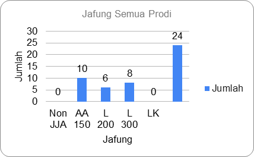 |
| Jafung SI | Batang | Jumlah | 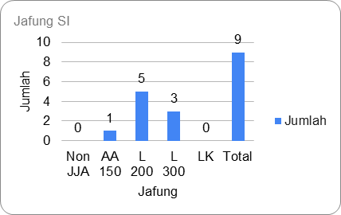 |
| Jafung BD | Batang | Jumlah | 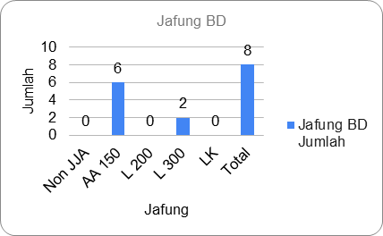 |
| Jafung IF | Batang | Jumlah | 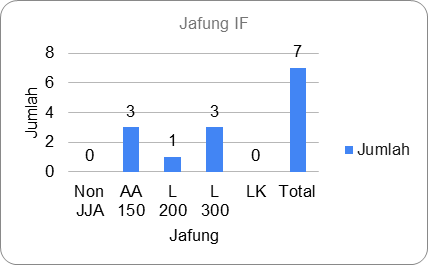 |
| Sertifikasi Dosen Semua Prodi | Batang | Jumlah | 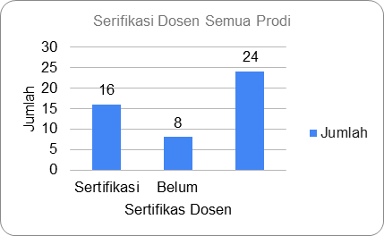 |
| Sertifikasi Dosen Prodi SI | Batang | Jumlah | 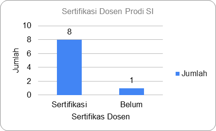 |
| Sertifikasi Dosen Prodi BD | Batang | Jumlah | 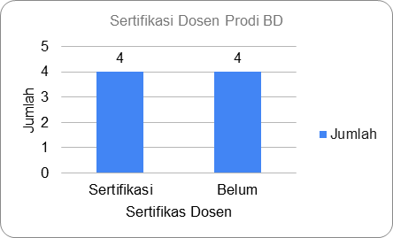 |
| Sertifikasi Dosen IF | Batang | Jumlah | 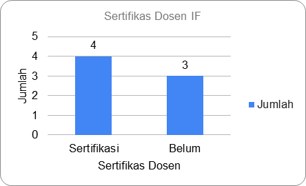 |

### Jafung & Serdos — per prodi (SI / IF / BD, pola sama)
4 grafik per prodi: Jabatan Fungsional Dosen (Batang), Status Jafung Dosen (Pie), Sertifikasi Dosen (Batang), Status Sertifikasi Dosen (Pie).

| Prodi | 1 Jafung | 2 Status Jafung | 3 Serdos | 4 Status Serdos |
|---|---|---|---|---|
| SI | 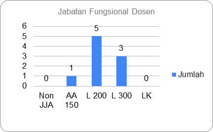 |  | 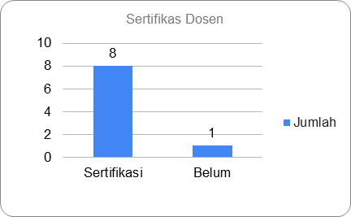 | 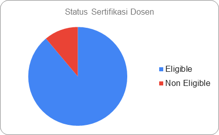 |
| IF | 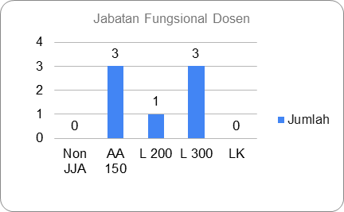 | 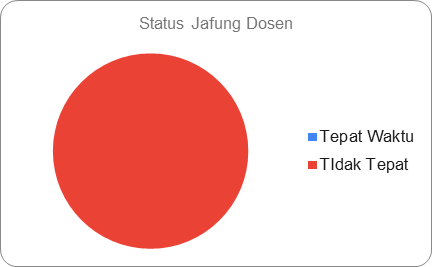 | 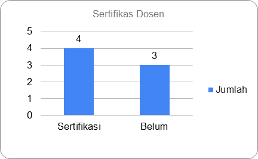 | 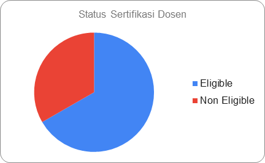 |
| BD | 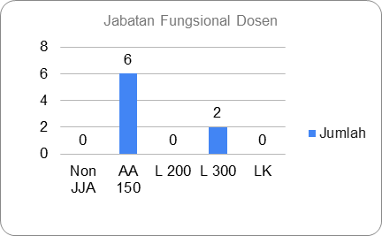 | 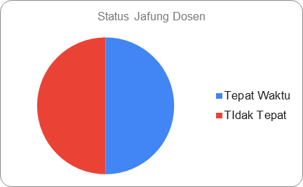 | 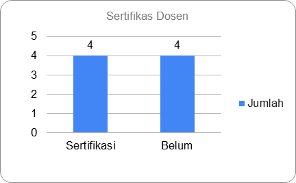 | 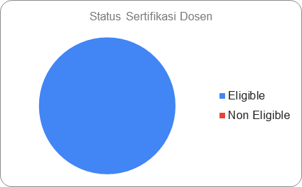 |

### Pendidikan Dosen (Pie, seri Jumlah)
| Semua Prodi | SI | IF | BD |
|---|---|---|---|
| 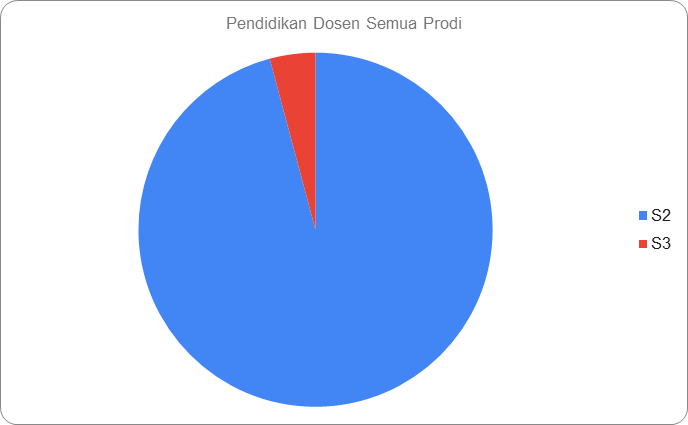 | 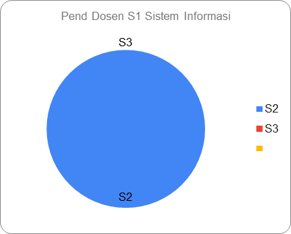 | 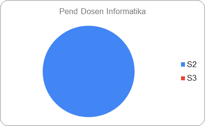 | 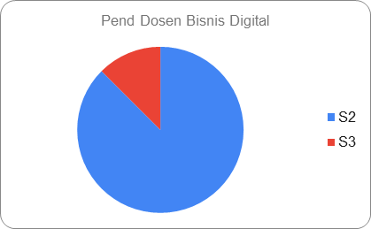 |

### Dosen per Prodi & Kampus (Pie)
| Sistem Informasi | Informatika | Bisnis Digital |
|---|---|---|
| 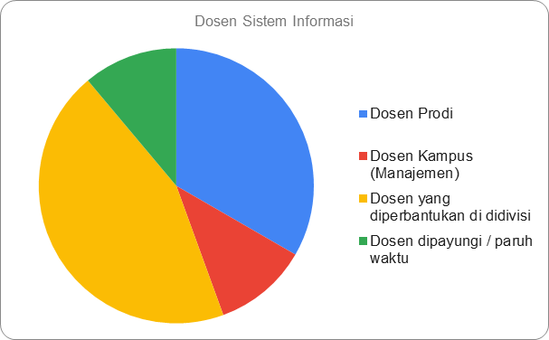 | 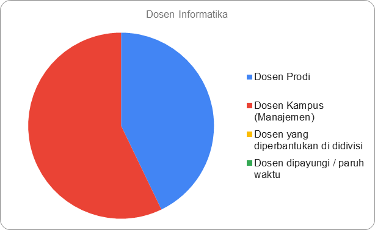 | 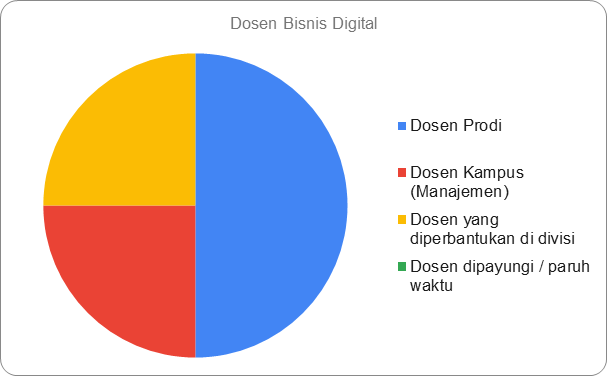 |

### Rasio Dosen & Mahasiswa (Batang, kategori = prodi)
| Grafik | Seri | Capture |
|---|---|---|
| Rasio Dosen & Mahasiswa | Jumlah Dosen, Jumlah Mahasiswa, Rasio | 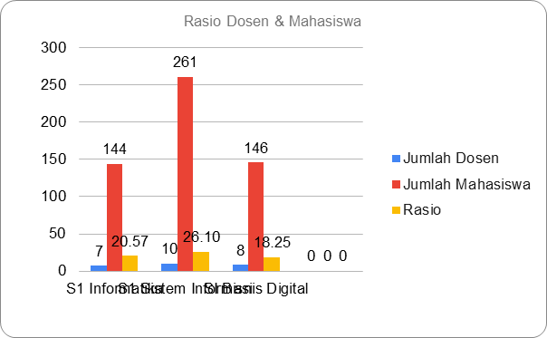 |
| Rasio Genap 2025/2026 | Jumlah Dosen, Jumlah Mahasiswa, Rasio | 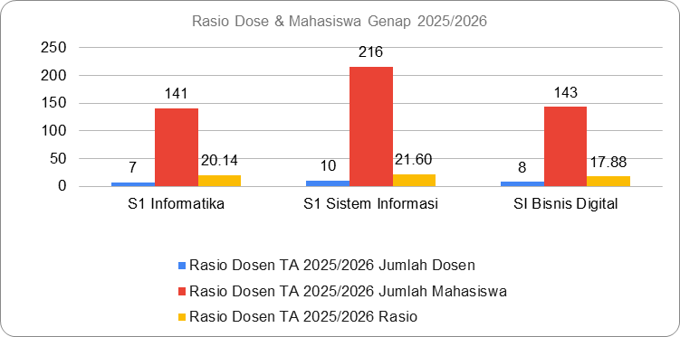 |
| Rasio + target | Jumlah Dosen, Jumlah Mahasiswa, Rasio, Target, Kekurangan | 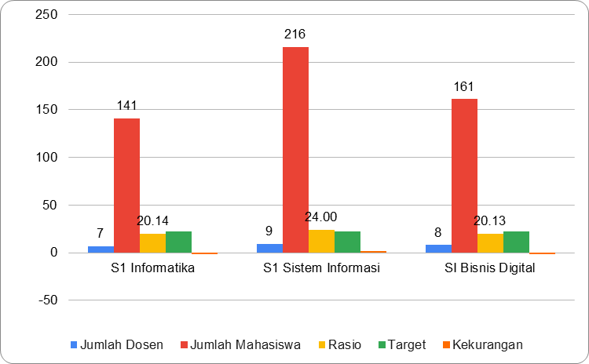 |

### Kompetensi Dosen per prodi & tahun (SI / IF / BD × 2025 / 2026)
Pola per sheet: (1) Nilai Kompetensi Dosen — Batang, seri Personal vs Jabatan; (2) Jumlah Dosen Yang Mempunyai Sertifikat Kompetensi — Pie; (3) Jumlah Dosen Yang Menguasai MK Prodi — Batang, seri Actual. SI juga punya (4) Rasio Dosen — Batang.

| Sheet | 1 Nilai | 2 Sertifikat | 3 Penguasaan MK | 4 Ekstra |
|---|---|---|---|---|
| SI 2025 | 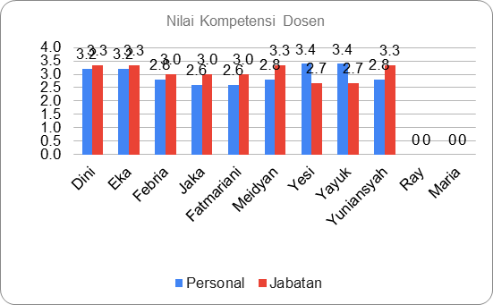 | 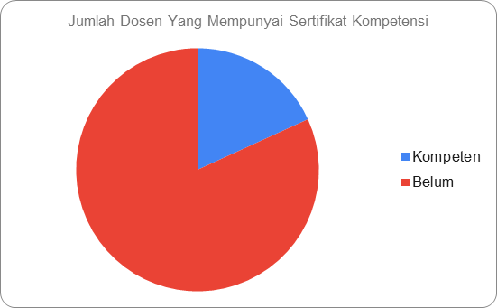 | 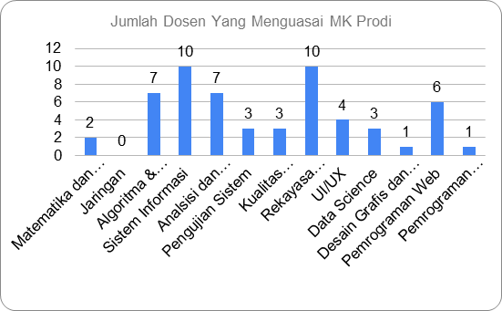 | 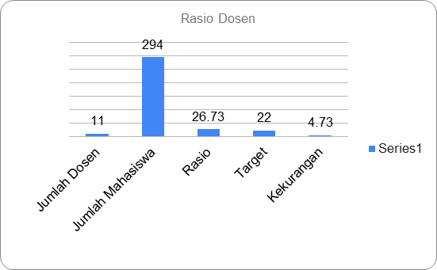 |
| SI 2026 | 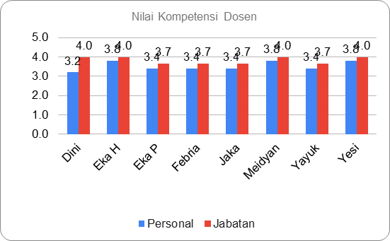 | 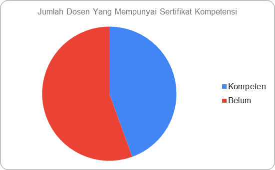 | 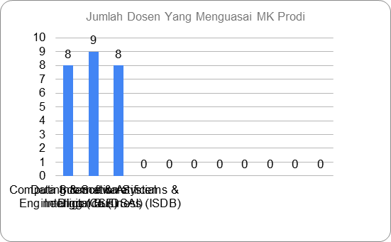 |  |
| IF 2025 |  | 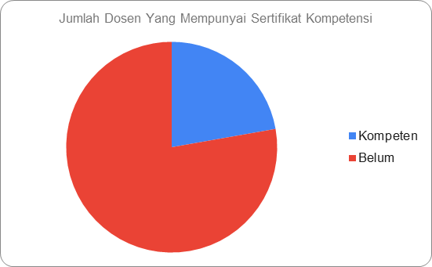 | 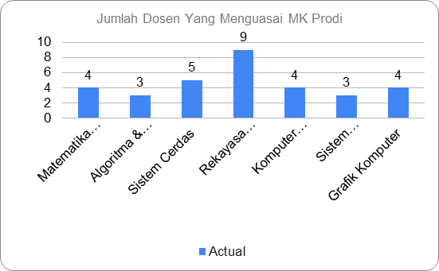 | |
| IF 2026 | 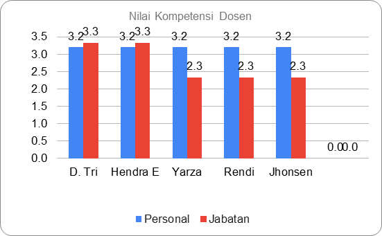 | 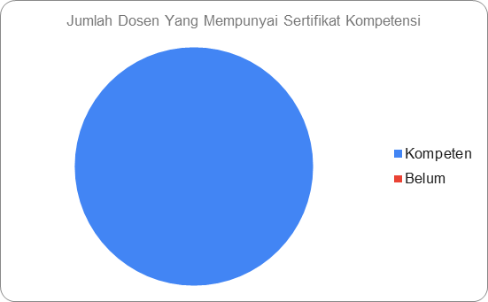 | 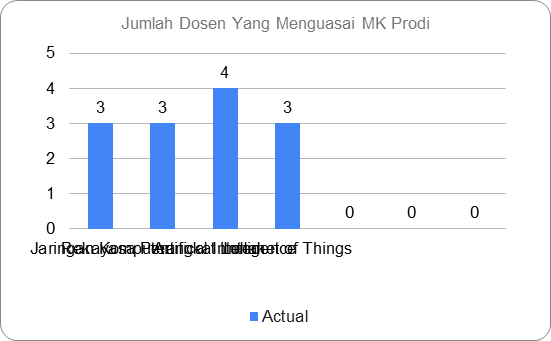 |   |
| BD 2025 | 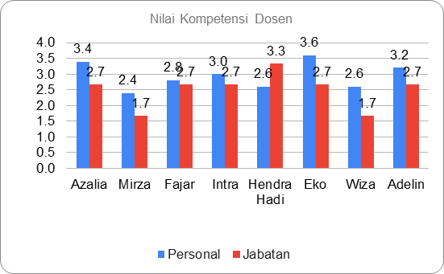 |  | 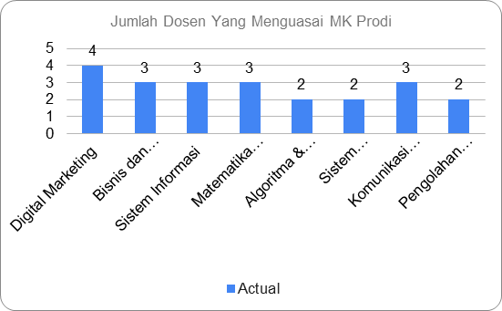 | |
| BD 2026 | 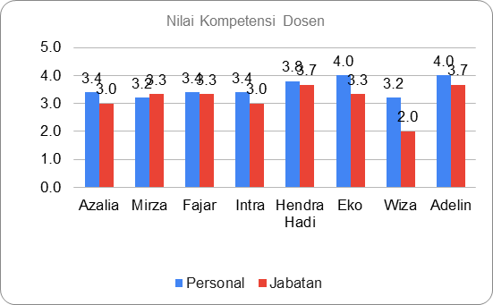 |  | 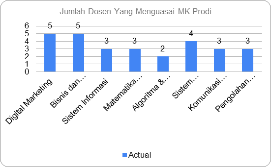 | |

### Turn Over, Keterlambatan, Absensi (Batang)
| Grafik | Seri | Capture |
|---|---|---|
| Turn Over Dosen | 4 seri | 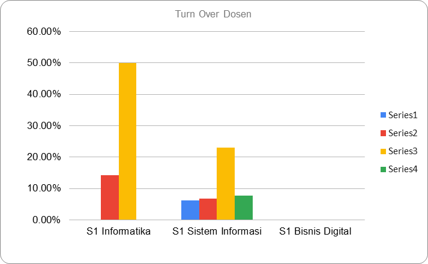 |
| Keterlambatan | Rata-rata (Menit) Jan–Jun | 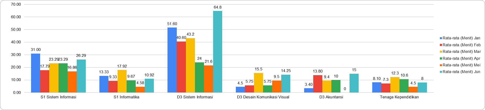 |
| Absensi 1–6 | Absensi (Hari) Jan–Jun | 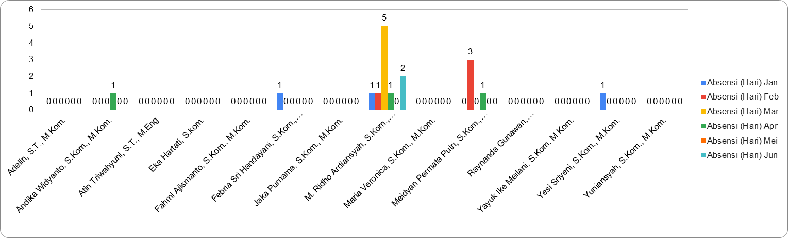 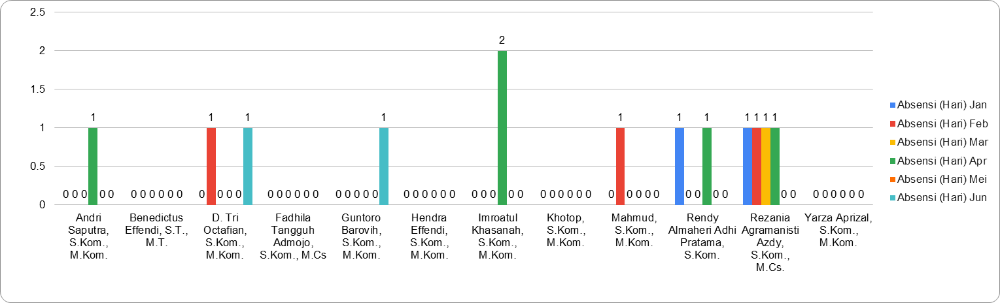 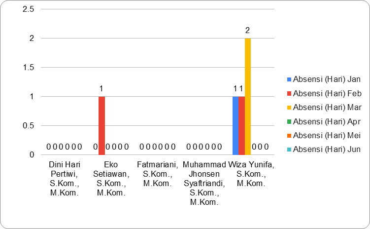    |

Sheet tanpa grafik (data/tabel): Penguasaan MK *, Rencana Sertifikasi Dosen, SUMMARY, Note standar dosen/kinerja/mutu, Rapot (cth), KPI, sheet per dosen (rapor individu), Resume BD.

## Dashboard HRD

### Peta DISC — "Profil Kompetensi dan Komitmen" (Pie per unit)
| Prodi SI | Prodi IF | Prodi BD |
|---|---|---|
|  |  |  |

| SarPras | Perpustakaan | Sales & Marketing |
|---|---|---|
|  |  |  |

Sheet tanpa grafik: DISC Tim warek2 (tabel), Data Keterlambatan, Data Kehadiran, Data Karyawan All, Helper, db.
