# Relasi Database HRD ↔ API eUniversity

**Diperbarui:** 27 Oktober 2026 · sumber: foreign key di database `hrd` (prefix tabel `hrd_`) dan `SinkronAkademik` / `Sinkron`.

Database HRD berisi dua jenis tabel:

- **Salinan API** (cermin): isinya hanya dari sinkron (`hrd:sync` / menu Sinkron eUniversity), tidak diubah manual,
  dan setiap baris membawa kunci asli eUniversity (`api_id`).
- **Milik HRD**: data proses & penilaian SDM yang tidak ada di eUniversity. Tabel ini merujuk tabel salinan lewat foreign key,
  sehingga setiap data HRD selalu terhubung ke pegawai, dosen, atau prodi di eUniversity.

## 1. Diagram relasi

```mermaid
erDiagram
    %% ===== Salinan API eUniversity =====
    STAFFS {
        bigint id PK
        bigint api_id UK "idStaff (/staff)"
        string nip "Nip"
        int id_divisi "idDivisi"
        int id_level "idLevel"
        bigint atasan_id FK "isian HRD"
    }
    DOSENS {
        bigint id PK
        bigint api_id UK "idDosen (/dosen)"
        bigint staff_id FK "tautan ke pegawai"
        bigint prodi_id FK "homebase (isian HRD)"
        smallint jumlah_pa "/dosen-pa"
        bool penguji "/pkl-skripsi/penguji"
    }
    PRODI {
        bigint id PK
        bigint api_id UK "idPStudi (/prodi)"
        string jenjang
    }
    KURIKULUM {
        bigint id PK
        bigint api_id UK "idKurikulum (/kurikulum)"
        bigint prodi_api_id FK
        string kode "kdKurikulum"
    }
    ANGKATAN {
        bigint id PK
        bigint api_id UK "idAngkatan (/angkatan)"
        bigint prodi_api_id FK
        bigint id_kurikulum_api FK
    }
    PERIODE_KRS {
        bigint id PK
        bigint api_id UK "idKRS (/krs)"
        string tipe
        string tahun_akademik
    }
    STRUKTUR {
        bigint id PK
        bigint api_id UK "idStruktur (/struktur)"
        int id_divisi
        int id_level
    }
    MENGAJAR {
        bigint id PK
        bigint id_grup UK "idGrup (/krs/{id}/grup)"
        bigint dosen_api_id FK
        bigint id_krs FK
        string kode_mk "kodeMateri"
    }
    BIMBINGAN {
        bigint id PK
        bigint api_id "id (/pkl-skripsi/{jenis}/{idKRS})"
        string jenis
        bigint id_krs FK
        bigint dosen_id FK
        bigint prodi_id FK
    }
    RASIO_PRODI {
        bigint id PK
        bigint prodi_id FK
        string tahun_ajaran
        int jumlah_mahasiswa "/mahasiswa?status=aktif"
    }

    %% ===== Milik HRD =====
    AKUNS { bigint id PK
        bigint api_id UK "id user (/auth/login)"
        bigint staff_id FK
        bigint dosen_id FK }
    PENGAJUAN { bigint id PK
        bigint staff_id FK
        bigint jenis_pengajuan_id FK
        bigint jenis_cuti_id FK }
    JENIS_PENGAJUAN { bigint id PK }
    JENIS_CUTI { bigint id PK }
    PEJABAT { bigint id PK
        bigint staff_id FK
        string peran }
    DISC { bigint id PK
        bigint staff_id FK }
    KEHADIRAN { bigint id PK
        bigint staff_id FK
        smallint tahun
        tinyint bulan }
    RIWAYAT_PENDIDIKAN { bigint id PK
        bigint staff_id FK
        bigint dosen_id FK }
    MK_INTI { bigint id PK
        bigint prodi_id FK
        bigint id_kurikulum_api FK
        string kode_mk "kodeMateri" }
    MK_DOSEN { bigint mk_inti_id FK
        bigint dosen_id FK }
    KOMPETENSI { bigint id PK
        bigint dosen_id FK }
    CAPAIAN_DOSEN { bigint id PK
        bigint dosen_id FK }

    %% --- relasi antar salinan API ---
    STAFFS ||--o{ STAFFS : "atasan"
    STAFFS ||--o| DOSENS : "orang yang sama"
    PRODI ||--o{ KURIKULUM : "punya"
    PRODI ||--o{ ANGKATAN : "punya"
    KURIKULUM ||--o{ ANGKATAN : "dipakai"
    PRODI ||--o{ DOSENS : "homebase"
    DOSENS ||--o{ MENGAJAR : "mengampu"
    PERIODE_KRS ||--o{ MENGAJAR : "periode"
    DOSENS ||--o{ BIMBINGAN : "membimbing"
    PERIODE_KRS ||--o{ BIMBINGAN : "periode"
    PRODI ||--o{ BIMBINGAN : "prodi mhs"
    PRODI ||--o{ RASIO_PRODI : "per TA"
    STRUKTUR ||..o{ STAFFS : "divisi x level (divalidasi form)"

    %% --- data HRD -> salinan API ---
    STAFFS ||--o| AKUNS : "login"
    DOSENS ||--o| AKUNS : "login"
    STAFFS ||--o{ PENGAJUAN : "mengajukan"
    JENIS_PENGAJUAN ||--o{ PENGAJUAN : "jenis"
    JENIS_CUTI ||--o{ PENGAJUAN : "cuti"
    STAFFS ||--o{ PEJABAT : "peran"
    STAFFS ||--o| DISC : "peta karakter"
    STAFFS ||--o{ KEHADIRAN : "rekap bulanan"
    STAFFS ||--o{ RIWAYAT_PENDIDIKAN : "pendidikan"
    DOSENS ||--o{ RIWAYAT_PENDIDIKAN : "pendidikan"
    PRODI ||--o{ MK_INTI : "MK inti"
    KURIKULUM ||--o{ MK_INTI : "kurikulum"
    MK_INTI ||--o{ MK_DOSEN : "dikuasai"
    DOSENS ||--o{ MK_DOSEN : "menguasai"
    DOSENS ||--o{ KOMPETENSI : "skill"
    DOSENS ||--o{ CAPAIAN_DOSEN : "roadmap, sertifikat, publikasi"
```

## 2. Tabel salinan API

| Tabel HRD | Kunci API | Endpoint sumber | Langkah sinkron | Isian HRD di tabel yang sama |
|---|---|---|---|---|
| `staffs` | `api_id` = `idStaff` | `/staff`, `/users` (status login) | Pegawai & Dosen | `atasan_id`, `status_kepegawaian`, `pendidikan_terakhir`, `tanggal_keluar`, `kontrak_berakhir` |
| `dosens` | `api_id` = `idDosen` | `/dosen`, `/dosen-pa`, `/pkl-skripsi/penguji` | Pegawai & Dosen, PA, Penguji | `staff_id`, `program_studi`/`prodi_id`, jafung, TMT, serdos, pendidikan |
| `prodi` | `api_id` = `idPStudi` | `/prodi` | Program Studi | – |
| `kurikulum` | `api_id` = `idKurikulum` | `/kurikulum` | Kurikulum | – |
| `angkatan` | `api_id` = `idAngkatan` | `/angkatan` | Angkatan | – |
| `periode_krs` | `api_id` = `idKRS` | `/krs` | Periode Kuliah | – |
| `struktur` | `api_id` = `idStruktur` | `/struktur` | Struktur Divisi × Level | – |
| `mengajar` | `id_grup` = `idGrup` | `/krs/{idKRS}/grup` (6 periode terakhir) | Kelas yang Diampu | – |
| `bimbingan` | (`jenis`, `api_id`) | `/pkl-skripsi/{jenis}/{idKRS}` (6 periode yang dilayani) | Bimbingan PKL/Skripsi | – (pembimbing dicocokkan ke `dosen_id` lewat nama) |
| `rasio_prodi` | (`prodi_id`, `tahun_ajaran`) | `/mahasiswa?status=aktif&fields=idMhs,idPStudi,Angkatan` | Jumlah Mahasiswa Aktif | – |
| `akuns` | `api_id` = id user | `/auth/login`, `/auth/otp/verifikasi` | saat login | `peran` (dari role API + data pegawai) |

## 3. Tabel milik HRD dan rujukannya ke data API

| Tabel | Merujuk | Jika rujukan hilang dari eUniversity |
|---|---|---|
| `pengajuan` | `staffs.id` | **dicegah** (restrict): pegawai berarsip pengajuan hanya dinonaktifkan oleh sinkron |
| `pejabat` | `staffs.id` | ikut terhapus |
| `disc`, `kehadiran` | `staffs.id` (akun utama per NIP) | dipindah ke akun lain ber-NIP sama; bila tidak ada, ikut terhapus |
| `riwayat_pendidikan` | `staffs.id`, `dosens.id` | rujukan dikosongkan, riwayat tetap |
| `mk_inti` | `prodi.id`, `kurikulum.api_id`; `kode_mk` = `kodeMateri` | rujukan dikosongkan |
| `mk_dosen` | `mk_inti.id`, `dosens.id` | ikut terhapus |
| `kompetensi`, `capaian_dosen` | `dosens.id` | ikut terhapus |
| `akuns` | `staffs.id`, `dosens.id` | rujukan dikosongkan |
| `jenis_pengajuan`, `jenis_cuti`, `pengaturan` | – (konfigurasi HRD) | – |

## 4. Aturan relasi

1. **Satu orang, banyak akun staf.** NIP sama bisa punya beberapa baris `staffs` (beda divisi). Data per orang (`disc`, `kehadiran`)
   disimpan di **akun utama**: akun aktif dulu, lalu id terkecil (`Staff::utama()`).
2. **Prodi dari nama.** Kolom `program_studi` tetap sebagai label, sedangkan `prodi_id` diisi otomatis saat disimpan
   (trait `TautProdi`). "D3 Akuntansi" ditautkan ke Akuntansi jenjang Diploma Tiga; nama lain ditautkan ke prodi S1.
3. **Divisi × level** pegawai tidak memakai FK (sinkron pegawai berjalan sebelum struktur), tapi divalidasi ke `struktur` di form pegawai.
4. **Urutan sinkron** mengikuti ketergantungan FK: Pegawai & Dosen → Prodi → Kurikulum → Periode → Angkatan → Struktur →
   Mahasiswa → PA → Penguji → Kelas diampu → Bimbingan → Tautan MK.
5. **Data API diutamakan.** Isian HRD hanya untuk data yang tidak ada di eUniversity. Usulan pemindahannya ke eUniversity ada di
   [usulan-data-induk-api.md](usulan-data-induk-api.md).
